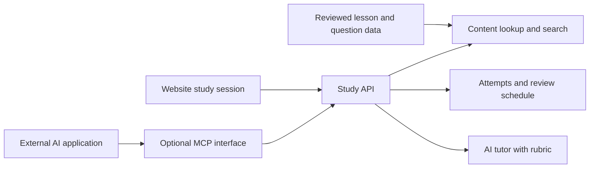

# Gradient Path learning audit

> **Progress note, 7 September 2026.** The seven rows in *Corrections to make* are applied — see the Status column and the notes beneath it. Everything else in this report is unchanged and still open.

Reviewed 7 September 2026. The biggest opportunity is to turn the existing material into a repeatable cycle of attempting, receiving feedback, and recalling it later. Content correction should come first because an AI tutor can repeat mistakes in its source material.

I inspected the live homepage and representative Linear Algebra and LLM lessons, including a 390-pixel phone layout. I inventoried all six local modules, checked local page/anchor links, and reviewed the generators, prompts, progress code, and deployment structure. This is a product and curriculum audit with factual spot checks, not a certification of every explanation or code sample. Role-specific priorities below assume AI/ML engineering with data engineering relevance, consistent with the existing site prompts.

**What is already present**

| Module | Cards/patterns | Existing strengths |
|---|---:|---|
| Linear Algebra | 38 | Geometry, worked arithmetic, matrix decompositions, transformer applications |
| Blind 75 | 18 | Pattern recognition, Python templates, mapped problem names |
| Machine Learning | 48 | Models, evaluation, neural networks, production failures |
| LLMs | 51 | Transformers, RAG, agents, MCP, evaluation, serving |
| Statistics | 40 | Inference, experimentation, causality, evaluation uncertainty |
| System Design | 22 | Sizing, budgets, reusable components, worked design rounds |

That is 217 cards/patterns. The five non-coding modules contain 597 revealable drill questions. The site also has tutor prompts, a suggested path, Simple/Technical explanations, manual New/Fuzzy/Solid marks, and a picker that favours fuzzy topics. These are assets to reuse.

The distinction that matters: the drills exist, but the site has no answer entry, scoring history, review dates, or record of whether an answer was attempted before it was revealed. The tutor prompts describe a useful conversation, but the website does not receive its results.

**Corrections to make before expanding the curriculum**

| Finding | Correction | Status |
|---|---|---|
| The Linear Algebra “Trace & Frobenius Norm” card describes AdamW decay as adding a penalty gradient. | Explain decoupled weight decay: AdamW shrinks parameters separately from the adaptive gradient update. Adding an L2 penalty to the loss is not generally equivalent under Adam. The ML optimiser card already explains the distinction more accurately, so reconcile the modules. [PyTorch AdamW documentation](https://docs.pytorch.org/docs/2.14/generated/torch.optim.AdamW.html) | **Done.** Rewritten as decoupled decay in `01-linear-algebra.html#trace-frobenius`, cited to the PyTorch 2.14 page with a checked date, and cross-linked to `03-machine-learning.html#optimisers`. |
| The “Covariance & Gram Matrices” card says scikit-learn PCA never builds a covariance matrix. | Qualify by solver and version. `covariance_eigh` explicitly constructs the covariance matrix; `auto` can select it. Preserve the useful explanation of SVD's numerical advantages without making an absolute claim. [scikit-learn PCA documentation](https://scikit-learn.org/stable/modules/generated/sklearn.decomposition.PCA.html) | **Done.** Qualified by solver in `#covariance-gram`: `covariance_eigh` (added 1.5) builds it deliberately, and `auto` selects it for exactly the (1000, 20) `X` in that card's own code block. Cited and dated. |
| The cosine card says a short note and long report about the same topic score identically. | Cosine ignores vector magnitude. Same topic does not imply the same embedding direction or equal similarity to a query. Rewrite the example as two positive scalar multiples of the same nonzero vector. [Cosine similarity definition](https://scikit-learn.org/stable/modules/generated/sklearn.metrics.pairwise.cosine_similarity.html) | **Done.** Reframed across six places — kicker (card and block prompt), simple lede, trap, drill 3 and its answer, and the figure panel title `SAME TOPIC` → `SAME DIRECTION`. The figure and code already showed scalar multiples; only the prose disagreed. |
| The dot-product picture calls the result the shadow of one vector on the other without a normalisation qualification. | A scalar projection onto a nonzero vector is the dot product divided by that vector's norm. Label the reference direction as a unit vector, or show that extra factor. Also replace the implication that zero means no relationship with the precise geometric claim: perpendicular vectors. | **Done.** The figure label now spells the shadow out as `u·v` divided by the length of `u`, and the caption states that the dot product is that shadow scaled back up by ‖u‖, equal to it only when u is a unit vector. “Nothing to do with each other” → “at right angles”. |
| Simple mode promises plain language but older modules retain notation in shared traps, questions, and summaries. | Give shared questions and summaries explicit plain-language variants. Hiding the main formula slab does not make the whole lesson notation-free. | **Done for modules 01, 03 and 04** (137 cards). 137 traps, 411 drill answers and 137 anchor summaries now carry plain variants in the two-layer markup `gpkit/build.py` already emits for 05/06; 81 shared blocks that held notation (questions, anchor bullets, real-world blocks) were rewritten in place. Verified in-browser: **0** rendered math reachable in Simple mode in any of the three, with the technical layer byte-identical. |
| The homepage promises that nothing depends on an idea further down the path. | Describe this as a suggested order, then add actual prerequisite links. Early gradient-descent material uses calculus before the later matrix-calculus card, for example. | **Done.** `index.html` now reads “a suggested order, not a dependency graph” and links three forward references verified against the pages: Dot Product (3) → Attention Math (34), Vector Spaces and Rank → PCA (27), and the early Linear Algebra cards' use of RAG, taught two modules later. |
| The Linear Algebra Foundation introduction says nine ideas while the block contains eleven. | Generate narrative counts from the same module data as the badges. | **Done, plus the cause.** The literal is corrected, and `tierhead_html` and the deck now fill `{N}` / `{n_word}` / `{n}` from `len(cards)`; a hard-coded count that disagrees stops the build. Modules 05/06 rebuild byte-identical, so no shipped page changed. |

The pages contain many named papers, production claims, and performance numbers, but no external reference anchors inside the six module pages. Add source links, a checked date, relevant library/model versions, and a distinction between measured results and illustrative estimates. Review sweeping words such as “always,” “never,” and “every” across the corpus. For numerical demonstrations, store the small calculation behind the illustration so the chart, prose, and answer agree.

*Status: partly done, and the sweep is still open.* Source links and a checked date exist on the two cards corrected above and nowhere else, so the six module pages remain almost entirely unanchored. Sweeping words were tightened only where a correction already touched the sentence — the claim that scikit-learn “never forms” the normal equations is now scoped to `LinearRegression`, and the PCA claim is scoped by solver — but the corpus was not reviewed for “always”, “never” and “every”. Two agreement defects were fixed where the corrections surfaced them: the cosine anchor bullet contradicted its own drill answer about top-k ordering, and a code comment described the wrong line. Neither the citation sweep nor a corpus-wide agreement check has been run.

**The learning features with the highest value**

| Priority | Feature | Behaviour to aim for |
|---|---|---|
| First | Today's practice | Start one bounded session: due reviews, one new concept, a few questions, a short explanation in your own words. Let the learner choose a time budget. |
| First | Recorded quizzes | Accept an answer before revealing the solution. Save the question, answer, result, hint use, confidence, and date. |
| First | Scheduled review | Give previously learned topics a return date. Incorrect answers return sooner; successful delayed recall extends the interval. |
| First | Mistake notebook | Show the original misconception, corrected reasoning, and a fresh question that tests it again. |
| Next | Mastery by skill | Track explanation, calculation, implementation, and tradeoff reasoning separately. Keep self-confidence as a separate signal. |
| Next | Search and exact resume | Search all topics; resume the exact unfinished card or question. Make prerequisite and related-topic labels clickable. |
| Next | Mixed interview practice | Ask questions without revealing the topic name, combine modules, and add a timer and review rubric. |
| Next | Export and optional sync | Export/import progress first; add account-based sync if studying across devices matters. |

The current random picker prefers fuzzy topics, then new topics, and only falls back to all topics when neither remains. A topic marked solid can therefore receive no review for a long time. Its state stores only the latest label, so past mistakes and past fuzzy marks are lost. The homepage also treats Blind 75 as a sequential unfinished stop even though its prose says coding runs alongside the other material. Make coding a parallel practice lane.

Research supports testing as part of learning: in Roediger and Karpicke's experiments, retrieval practice improved delayed recall compared with additional reading, while reading increased confidence. Applying that principle here means measuring an unaided answer after a delay. It does not establish one universally optimal review interval for interview preparation. [Original study](https://learninglab.psych.purdue.edu/downloads/2006/2006_Roediger_Karpicke_PsychSci.pdf)

For an initial scheduler, 1, 3, 7, 14, and 30 days can be configurable starting intervals. Treat these as a product heuristic and adjust them using performance and daily workload. Cap the review queue to the selected time budget. A same-session correct answer after seeing a hint should not count as independent mastery.

**What a quiz should contain**

Use the existing three drills as the first question bank, after reviewing their correctness. Add variants that test transfer rather than memorisation. A section checkpoint should mix several cards.

| Question type | Example for gradient descent |
|---|---|
| Explain | Explain what the learning rate changes, without a formula. |
| Predict | Predict what happens when the step size becomes too large. Commit before running the animation. |
| Calculate | Given `f(w) = w²`, `w = 3`, and learning rate `0.1`, calculate the next value. |
| Debug | Find why a short training loop accumulates gradients unexpectedly. |
| Transfer | Loss oscillates. Explain what you would inspect and how you would distinguish possible causes. |

Multiple choice is useful for targeted misconceptions, but include typed answers, calculations, and explanation aloud. Grade numerical questions with explicit tolerances; grade executable exercises using behaviour checks; use AI with a visible rubric for open answers. A simple rubric is 0 = incorrect, 1 = partial, 2 = correct with support, 3 = independently correct with reasoning. Label AI assessments as provisional and allow correction.

As an initial mastery rule, require successful unaided attempts on different days and a new example. This is an adjustable design choice, not a claim that a particular score predicts hiring success.

**Visualisation and worked-example improvements**

The desktop typography, consistent colour scheme, and paired concept/arithmetic figures work well. The current figures are static. Make a small number of high-value figures interactive and attach a question to each action.

| Topic | Interaction | What to ask first |
|---|---|---|
| Dot product/cosine | Drag a vector; switch normalisation on/off | Which scores change if only the vector length doubles? |
| Gradient descent | Change learning rate; step or reset | Will the next step reduce the loss? |
| Confusion matrix | Move the threshold; update counts and error costs | Which error becomes more frequent? |
| PCA | Rotate a projection line through a small point cloud | Which direction preserves more variance? |
| Attention | Select a token; reveal the causal mask and weights | Which tokens can it attend to? |
| RAG/chunking | Change boundaries and inspect retrieved context | Did the answer lose its units or section context? |
| System design | Adjust QPS, context length, and cache hit rate | Which budget or resource becomes the constraint? |
| Coding | Step through pointers, a queue, or a DP table | What changes next, and what invariant must remain true? |

Use a progression of one fully worked example, one partially completed example, and one unaided variant. Include a failure case and a short statement of the assumptions. For RAG demos, label simulated scores as simulated unless a real retrieval system produced them.

On the 390-pixel phone view, the dot-product diagram's arithmetic panel is off-screen inside a horizontal scroller. The swipe hint exists, so this is not missing content, but it makes comparison harder. Stack related panels vertically on small screens and add an expandable full diagram. A compact topic picker and previous/next controls would also reduce navigation effort on long module pages.

There is an accessibility defect: `generator/render_math.js` chooses HTML-only KaTeX output. Across the five mathematical modules I found 3,195 `aria-hidden` KaTeX visual spans and no MathML elements. The browser accessibility view omitted expressions from questions. Render `htmlAndMathml`, verify the result with assistive technology, and retain readable plain-language question variants. [KaTeX output options](https://katex.org/docs/options)

The site asks learners to read the picture first, but the sampled cards place several paragraphs above it. Move the visual above the long explanation or provide a “Start with the picture” learning mode.

**Curriculum additions for AI/ML engineering**

These are missing dedicated practice tracks, not claims that none of their terms appear anywhere in the site.

| Gap | Suggested coverage |
|---|---|
| SQL and data manipulation | Joins and their cardinality, window functions, aggregation, deduplication, NULLs, temporal joins, query plans; equivalent pandas tasks. |
| Python engineering | Iterators/generators, mutable defaults, typing, exceptions, testing, async I/O, profiling, packaging; short implementation and debugging tasks. |
| Data and serving infrastructure | Finish the Module 07 placeholder: APIs, containers, Kubernetes basics, queues, retries/idempotency, data contracts, batch/streaming pipelines, model deployment and rollback. |
| Calculus prerequisites | Scalar derivatives, chain rule, partial derivatives, a small backpropagation calculation, and links into the existing matrix-calculus/optimiser material. |
| Project and behavioural interviews | Explain a real project, personal contribution, a failed approach, a tradeoff, a disagreement, measurable impact, and what you would change. |
| Applied ML coding | Build a leakage-safe training pipeline, choose validation, compute metrics, debug shapes, and implement a tiny retrieval/evaluation pipeline. |

For data science roles, increase the weight of SQL, experimentation, and product cases. For software engineering roles, increase general backend design and coding. Add role presets and a short diagnostic so the learner can test out of familiar prerequisites.

**AI tutor, RAG, and MCP**

Assuming “MPC” means MCP: RAG and MCP solve different parts of this. RAG retrieves relevant material to use as answer context. MCP provides a standard interface through which an external AI application can access content and actions. A tutor can use both, but neither supplies a learning schedule or reliable grading automatically. [RAG paper](https://arxiv.org/abs/2005.11401), [MCP architecture](https://modelcontextprotocol.io/docs/learn/architecture)

Start with an in-page “Teach me / Quiz me / Explain my mistake” panel. For a question about the current card, pass that card's structured content directly to the tutor. For cross-topic questions, retrieve a small set of relevant sections, include their titles and source anchors, and require citations. A keyword-search baseline is sufficient to start evaluating retrieval; introduce embeddings and hybrid retrieval if measured misses justify them.

The current generated topic prompts include the title, follow-up, role, and general instructions. They do not carry the complete lesson, its evidence, or the learner's attempt history. Supplying those explicitly is the meaningful improvement over copying the prompt into a separate chat.

Give the tutor one-question-at-a-time behaviour, hints before full answers, links back to the source, and the ability to acknowledge insufficient evidence. Keep the scheduler and progress calculations in ordinary application code. Build a small reviewed evaluation set with correct, partly correct, incorrect, and confidently wrong answers before using AI grading to drive progress.

If an external agent is useful, expose a small authenticated MCP interface: `search_topics`, `get_topic`, `get_due_reviews`, `start_practice`, and `submit_answer`. The service should validate submitted attempts and compute progress; avoid an unrestricted “set mastery” tool. Browser `localStorage` is not automatically readable by an MCP server, so external tutoring needs an explicit progress API or an intentional export/import bridge. The same study service can serve the website and the MCP adapter.

An embedded tutor needs a server-side model connection, credentials kept off the public page, access control, and usage limits. Keep deterministic questions usable when the model service is unavailable. Voice practice can be added after text tutoring works well.

**Implementation order and acceptance checks**

1. Correct the sampled factual issues, add citations, and repair accessible math. Restore editable content sources for Modules 01, 03, and 04: `generator/retrofit.py` explicitly records that their original content files are gone. Preserve existing topic IDs and progress keys during recovery.
   *Status: the sampled factual issues are corrected and citations exist on two cards. **Accessible math is untouched** — `generator/render_math.js` still passes `output: 'html'`, and the five mathematical modules contain 3,070 `aria-hidden` KaTeX spans and zero MathML elements. **Content sources are still gone**, so the module 01/03/04 edits above were made directly in the built HTML and would be lost by a regeneration; topic IDs and progress keys were preserved throughout.*
2. Add a narrow practice pilot for roughly ten cards: reviewed questions, answer capture, rubric, attempt history, daily queue, review dates, and export/import. Verify that attempts survive reload, a previously solid card returns when due, hinted answers are distinguishable, and the daily time budget is respected.
3. Add two interactive lessons, such as dot product and threshold selection. Check that displayed values and answer checks agree, that reset/step controls work with the keyboard, and that phone users can see the complete explanation.
4. Add the grounded tutor over the same pilot. Check source references, unknown questions, misleading learner answers, grading disagreements, latency, and per-session usage.
5. Expand the question bank and role-specific curriculum, then add sync, MCP, and voice where they improve actual usage.

Use a shared content model containing topic ID, prerequisites, objectives, source references, content version, and question IDs. Store attempts separately with answer, score, assistance, confidence, time, and rubric version. Keep old New/Fuzzy/Solid marks as self-assessment during migration; do not reinterpret them as verified test results.

Keep the existing static reading pages if they remain useful. A full framework rewrite is not required to pilot quizzes. If assets or content JSON become separate files, update the Docker packaging: it currently copies only the root HTML files. The existing verification script also references an old `/tmp/gp/site` location, so adapt it to the actual project before relying on it for future changes.

All local page and fragment links passed the read-only link check, with no duplicate IDs found. I made no changes to site behaviour or deployed content during this audit; this report is the only added project file.

**A daily routine you can use immediately**

For a 20-minute session: spend 3 minutes answering yesterday's question without reading, 6 minutes on one new card and its worked example, 6 minutes attempting its drills, 3 minutes explaining it aloud with one changed assumption, and 2 minutes recording the mistake and the next review date. On shorter days, review existing material before adding another topic. Once a week, do one mixed timed problem and explain a project decision.

The first feature to build should be the daily quiz-and-review loop. Its success criterion is whether you can answer a changed question a week later, with less help—not how many cards you have opened.
